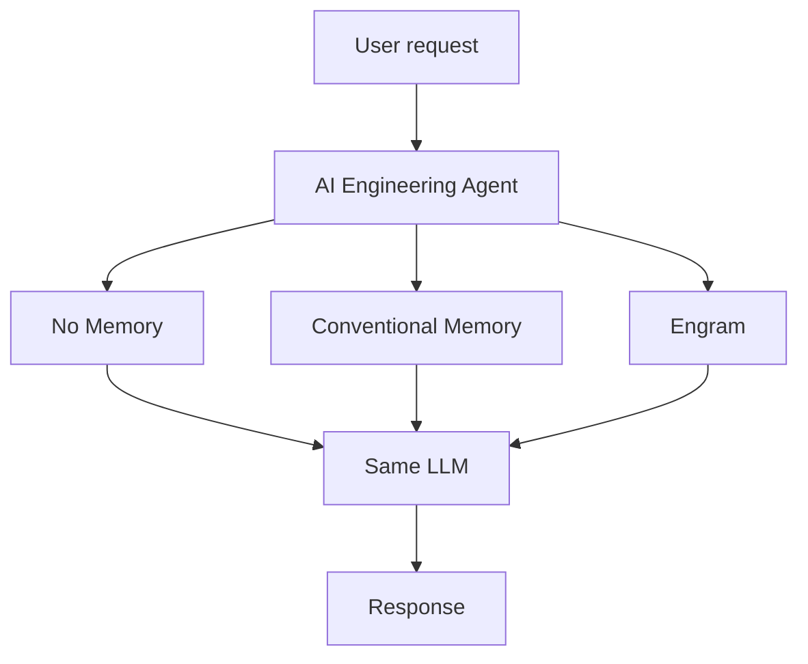

# ENGRAM — Three-Way Memory Architecture Demo

> **Intermediate research prototype.** This demonstration compares three memory
> architectures under identical conditions. It does not claim that every planned
> Engram subsystem is production complete.

## Purpose

The demo holds the LLM provider, model, system prompt, temperature, user
requests, tool outputs, and dataset constant. The only variable is the memory
architecture applied to each query.



Engram does not replace the agent or the LLM. The decision provider selects a
policy, Engram executes retrieval and manages context, and the agent asks the
same LLM to reason over the resulting information.

## The three architectures

| Architecture | Memory path | Externalization |
|---|---|---|
| **No Memory** | None — query goes straight to the LLM | No |
| **Conventional Memory** | Dense similarity search → fixed top-K → direct prompt injection | No |
| **Engram** | Decision → retrieval policy → dense + sparse → fusion → canonical memory → context management → DTOC → lightweight context package | Yes |

## Implemented in this slice

- `MemorySystem` interface with three implementations (`NoMemorySystem`,
  `ConventionalMemorySystem`, `EngramSystem`).
- `MemorySystemEvaluator` — system-agnostic driver with no per-system branching.
- `DemoConfig` — one shared configuration for all three systems.
- `BenchmarkResult` / `SystemReport` / `CaseOutcome` — observed metrics only.
- `scripts/evaluate_memory_systems.py` — full benchmark with aggregate and
  per-case output.
- `scripts/demo_comparison.py` — live side-by-side comparison.
- `scripts/demo_chat.py` — interactive CLI with a three-system menu, a
  Compare-All mode, and a scripted presentation walkthrough.
- Legacy two-way demo (`AgentMode` BASELINE vs ENGRAM) preserved unchanged.

## Dataset and scenarios

`data/demo/memories.json` contains 45 TaskFlow memories covering architecture,
security, pagination, error codes, and conflicting decisions. Historical
offset pagination is marked `superseded`; the current cursor policy is `active`.

`data/demo/evaluation_cases.json` contains 10 cases:

1. `case_01_knowledge` — basic knowledge retrieval
2. `case_02_exact_identifier` — exact error-code lookup
3. `case_03_identifier_trap` — similar-identifier disambiguation
4. `case_04_semantic` — semantic retrieval
5. `case_05_temporal_current` — current-state retrieval
6. `case_06_temporal_historical` — historical retrieval
7. `case_07_conflict` — conflict resolution (active vs superseded)
8. `case_08_hybrid` — hybrid retrieval
9. `case_09_large_tool_output` — context consumption (DTOC)
10. `case_10_artifact_restoration` — artifact restoration

## Run

From PowerShell at the repository root:

```powershell
uv run python -m scripts.evaluate_memory_systems
uv run python -m scripts.demo_comparison
```

or equivalently:

```powershell
python -m scripts.evaluate_memory_systems
python -m scripts.demo_comparison
```

Both scripts default to the deterministic echo provider (`--llm echo`) so they
run offline with no API keys. To use the live Groq LLM:

```powershell
python -m scripts.evaluate_memory_systems --llm groq
python -m scripts.demo_comparison --llm groq
```

The echo provider returns the prompt as the response, so the only difference
between systems is the context each architecture placed there. With `--llm groq`,
results are probabilistic and should be treated as an observable demo run rather
than a final scientific benchmark.

## Interactive demo

```powershell
uv run python scripts/demo_chat.py
```

The menu runs a question through one architecture or all three, replays the
canned scenarios, or executes the full presentation walkthrough:

```
1. No Memory              4. Compare All
2. Conventional Memory    5. Presentation Demo
3. Engram                 6. Metrics
                          0. Exit
```

**Compare All** sends one question through all three systems and prints each
system's answer plus the retrieval strategies, fusion method, decision provider
and artifact state it used.

**Presentation Demo** runs the scripted sequence — exact identifier → semantic →
temporal → conflict → large tool output / DTOC — then prints a summary. Output
is plain ASCII, so it renders identically in PowerShell, Windows Terminal, VS Code
and Linux/macOS terminals.

## Evaluation methodology

The evaluator drives all three systems through the `MemorySystem` interface. It
checks expected terms in the LLM's actual responses, detects forbidden terms,
measures recall@K and MRR against supporting memory IDs, and records latency,
context tokens, and DTOC metrics. No per-system logic lives in the evaluator.

Two metrics separate *right* from *grounded*:

- **Memory-Grounded Accuracy** — correct answers that cite retrieved evidence.
- **Unsupported Answer Rate** — memory-required cases answered with no evidence
  and no abstention.

A stateless agent can guess correctly from parametric knowledge. A correct guess
is not evidence that memory retrieval worked, which is exactly why the two are
reported separately.

Cost metrics report `token_usage_unavailable` when the LLM provider does not
return token usage (the current `ChatResponse` schema has no usage field).

## Fairness statement

- Same LLM provider, model, temperature, and system prompt for all three.
- Same dataset, namespace, embedding model, vector index, sparse index, and
  artifact store.
- Same tool output for tool cases.
- No system receives expected answers in its prompt.
- The evaluator contains no per-system branching.
- Conventional Memory is not weakened: it uses the same production embedding
  model and a reasonable fixed top-K.

## Known limitations

- The demo's canonical-memory adapter is in-process; use `PostgresMemoryProvider`
  for durable deployment.
- No graph retrieval, full temporal resolver, consolidation engine, public
  SDK/API, RBAC, or distributed observability is included.
- `packages/temporal` and `packages/lifecycle` are empty; Engram's temporal
  awareness comes from `metadata.state` ranking in `EngramSystem._apply_lifecycle`.
- Tool analysis keeps a deterministic, query-relevant evidence line while
  storing the full raw output; advanced DTOC relevance policies remain future
  work.
- The retrieval embedding used by the standalone demo is deterministic and
  local, not a quality embedding model.
- Cost metrics are unavailable because `ChatResponse` does not carry token
  usage.

## Next phase

The next architectural milestone is **ContextState → ContextOptimizer →
ContextPackage**. It should replace demo-specific prompt assembly with a
provider-neutral, measurable context-construction pipeline before adding more
storage providers.
