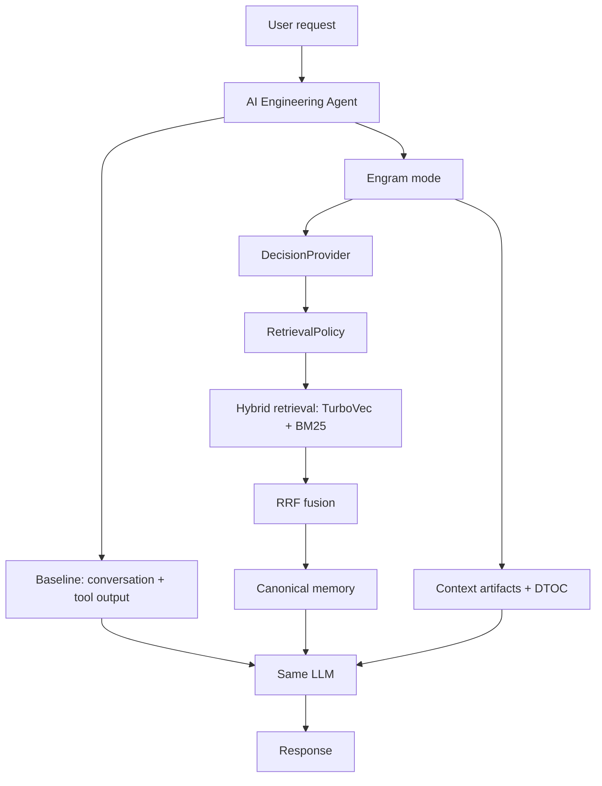

# ENGRAM — Half-Way Production Vertical Slice

> **Intermediate research prototype.** This demonstration proves a working memory-to-context path; it does not claim that every planned Engram subsystem is production complete.

## Purpose

The TaskFlow engineering-agent demo holds the LLM provider, model, system prompt, temperature, user requests, and tool outputs constant. Its only execution-mode difference is whether the agent receives Engram-produced memory and context.



Engram does not replace the agent or the LLM. The decision provider selects a policy, Engram executes retrieval and manages context, and the agent asks the same LLM to reason over the resulting information.

## Implemented in this slice

- MemoryProvider-based canonical memory, seeded with 15 TaskFlow decisions.
- TurboVec dense retrieval, BM25 sparse retrieval, and RRF fusion.
- RuleBasedDecisionProvider, with the runtime accepting any existing DecisionProvider such as Laya.
- ContextArtifactStore, ContextManager, and DTOC hiding for large tool output.
- Baseline and Engram modes in one controlled agent loop.
- Reproducible A/B evaluation and an end-to-end integration test.

The standalone demo uses a deterministic in-process MemoryProvider adapter so it can be reproduced without a database service. The existing PostgresMemoryProvider remains the canonical durable implementation for deployment.

## Dataset and scenarios

TaskFlow records cover React/TypeScript, FastAPI, PostgreSQL, Redis constraints, security-token policy, requirements, preferences, and the offset-to-cursor pagination migration. Historical offset pagination is marked `superseded`; the current cursor policy is `active`.

Ask the following in separate sessions:

1. `Why did we choose cursor pagination for TaskFlow?`
2. `How should authentication tokens be handled in TaskFlow?`
3. `Should Redis replace PostgreSQL to reduce load?`
4. `What pagination strategy did TaskFlow originally use, and what does it use now?`
5. `Analyze the recent TaskFlow backend changes and identify whether any authentication-related changes could violate our security requirements.`

The final scenario stores the full `search_codebase` output as an artifact, hides it with DTOC, presents a lightweight reference plus relevant evidence to the LLM, and verifies that the original content remains recoverable.

## Run

From PowerShell at the repository root:

```powershell
uv run python -m scripts.demo_engram
uv run python -m scripts.demo_evaluation
```

or equivalently:

```powershell
python -m demo
python -m scripts.demo_evaluation
```

The interactive prompt supports `/new` to clear agent-local conversation and start a new session, and `/quit` to exit. The Engram mode retains seeded/durable memory; baseline mode does not access it.

The evaluation defaults to a deterministic echo LLM provider (`DemoEchoLLMProvider`) so it runs offline and is reproducible: the response is exactly the prompt the agent built, so the only difference between modes is the context Engram placed there. To run against a real LLM instead, pass `--llm groq` (requires `GROQ_API_KEY` in `.env`):

```powershell
uv run python -m scripts.demo_evaluation --llm groq
```

## Evaluation methodology

`scripts/demo_evaluation.py` runs the same seven prompts in both modes with separate empty sessions. It checks expected terms in the LLM's actual responses rather than looking up an Engram-specific answer table. Engram receives only evidence returned through the decision → policy → hybrid retrieval path. The baseline receives no Engram memory or retrieval results.

The default echo provider makes the A/B fully deterministic: the same seven prompts, same agent loop, same tools, and the same LLM in both modes, with only the Engram-provided context differing. With `--llm groq`, results are probabilistic and should be treated as an observable demo run rather than a final scientific benchmark. Either way the script prints observed metrics, never hardcoded claims.

## Known limitations

- The demo's canonical-memory adapter is in-process; use PostgresMemoryProvider for durable deployment.
- No graph retrieval, full temporal resolver, consolidation engine, public SDK/API, RBAC, or distributed observability is included.
- Tool analysis keeps a deterministic, query-relevant evidence line while storing the full raw output; advanced DTOC relevance policies remain future work.
- The retrieval embedding used by the standalone demo is deterministic and local, not a quality embedding model.

## Next phase

The next architectural milestone is **ContextState → ContextOptimizer → ContextPackage**. It should replace demo-specific prompt assembly with a provider-neutral, measurable context-construction pipeline before adding more storage providers.
